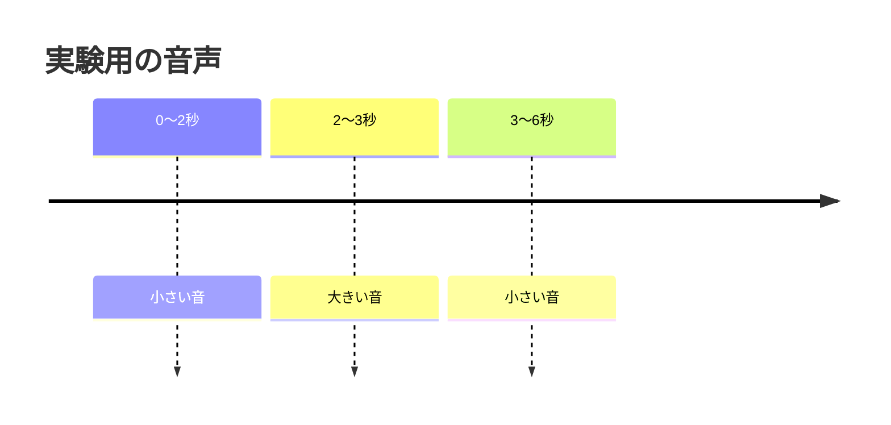

# 長い録音を波形から頭出しする｜wavesurfer.js

長い録音から話し始めを探すには、音の強弱が目印になります。音の大きい箇所がある実験用音声で、波形から再生位置を選びます。

## 最初に知っておく用語

- **波形**は、音の振幅を時間順に描いたものです。
- **頭出し**は、再生したい位置に移動することです。

## タイムラインで考える

区間ごとに音量の違いを示します。ライブデモでは波形から2秒付近を探します。

## ライブデモ

[公開用ライブデモ](https://papanda925.github.io/Daily-Code-Samples/demos/wavesurfer-seek/#live) ／ [実装HTML](../../docs/demos/wavesurfer-seek/index.html) ／ [共通JavaScript](../../docs/demos/browser-library-labs/daily.js)

1. 現行のブラウザーでデモを開く。Mermaidの描画や一部のライブラリーに外部通信を使用する。
2. 「実行」を押す。下記の値や画面内の操作欄を試す。

波形の山の手前をクリックする。再生を押す。

### 結果の見方

選んだ位置から音が流れる。

音の小さいところも再生できる。探したい発言の近くで音量が一定なら、書き起こしや時刻のメモを組み合わせる。

## コードの要点

再生せずに波形をクリックして位置を移し、その後に再生する。

実装はデモ画面の「実装コード」で確認できます。

## 仕事で使うとき

音の内容を判断するときは再生して聞く。波形は位置の目印に使う。

## 参考資料

- [wavesurfer.jsの参照資料](https://github.com/katspaugh/wavesurfer.js)
- [Mermaidの図の書き方](https://mermaid.js.org/intro/syntax-reference.html)

本文はAIを利用して作成しました。

## 実行環境と検証

JavaScriptの構文とファイル間の対応を確認した。 Pagesでの各機能の実行とMermaidの描画は検証範囲に含まれていない。

図が表示されない場合は、本文の読み方とMermaidソースを参照する。デモ欄に取得エラーが出る場合は通信条件を確認する。検証用の架空データを使う。
