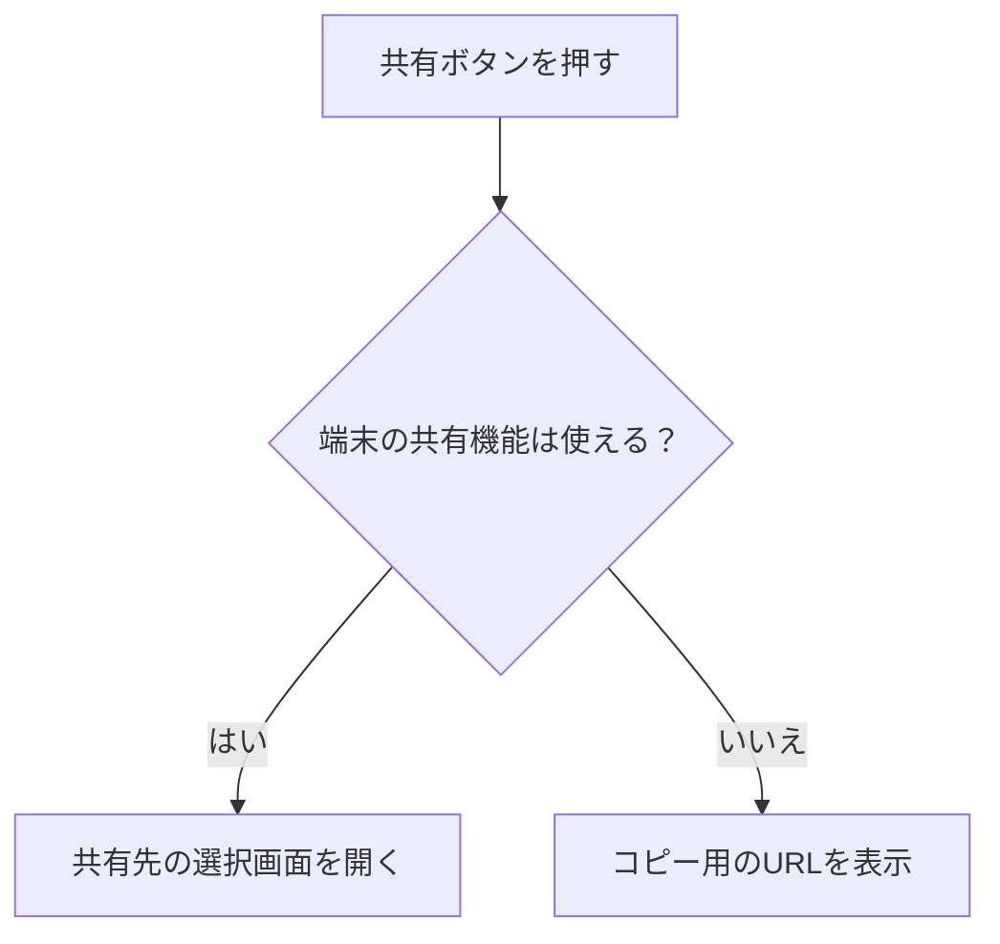

# 共有画面へ渡せる端末とコピーで共有する端末を扱う｜Web Share API

端末によっては、ブラウザーから共有先を選ぶ画面を呼び出せます。使える端末と使えない端末に、それぞれ操作を用意します。

## 最初に知っておく用語

- **共有シート**は、端末が表示する共有先の選択画面です。
- **フォールバック**は、ある機能が使えない場合の代わりの操作です。

## 分岐のフローチャートで考える

ひし形で「端末の共有機能は使える」を確認します。結果によって次に進む先が変わります。

## ライブデモ

[公開用ライブデモ](https://papanda925.github.io/Daily-Code-Samples/demos/web-share-fallback/#live) ／ [実装HTML](../../docs/demos/web-share-fallback/index.html) ／ [共通JavaScript](../../docs/demos/browser-library-labs/daily.js)

1. 現行のブラウザーでデモを開く。Mermaidの描画や一部のライブラリーに外部通信を使用する。
2. 「実行」を押す。下記の値や画面内の操作欄を試す。

共有を押す。選択画面が出た場合はキャンセルも試す。

### 結果の見方

非対応端末では共有URLを選択できる。

選択画面を開いても送信先で受信したとは限らない。このデモは端末の共有処理へ渡した時点を表示する。

## コードの要点

ユーザー操作で navigator.share を呼び、未対応時はURLを表示する。

実装はデモ画面の「実装コード」で確認できます。

## 仕事で使うとき

共有したリンクは受け取る側の端末でも開けるか確認する。

## 参考資料

- [Web Share APIの参照資料](https://developer.mozilla.org/en-US/docs/Web/API/Web_Share_API)
- [Mermaidの図の書き方](https://mermaid.js.org/intro/syntax-reference.html)

本文はAIを利用して作成しました。

## 実行環境と検証

JavaScriptの構文とファイル間の対応を確認した。 Pagesでの各機能の実行とMermaidの描画は検証範囲に含まれていない。

図が表示されない場合は、本文の読み方とMermaidソースを参照する。デモ欄に取得エラーが出る場合は通信条件を確認する。検証用の架空データを使う。
