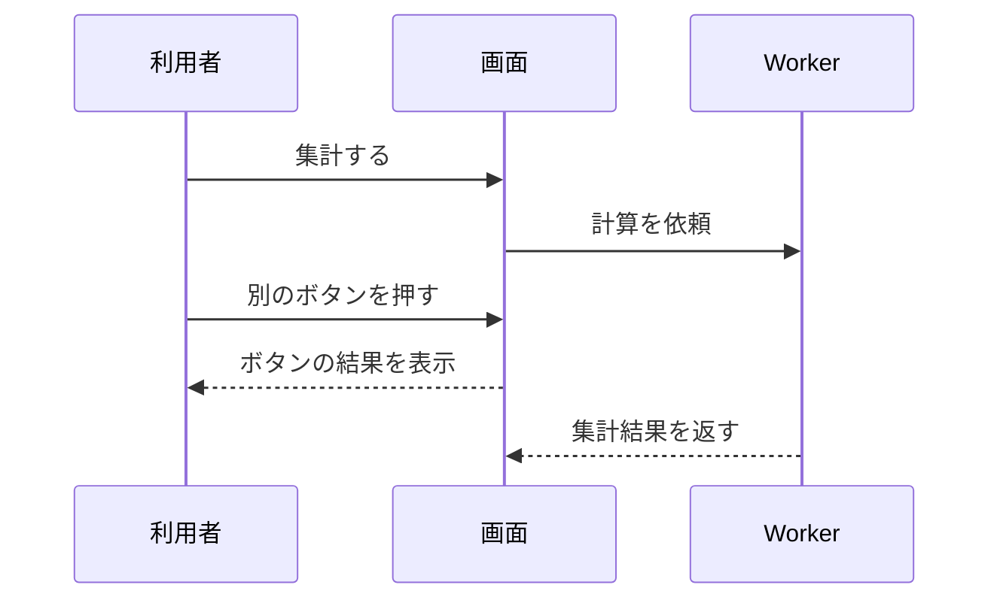

# 集計中も画面のボタンを操作できるようにする｜Web Workers

大きな集計を画面と同じ場所で実行すると、ボタンの反応が後回しになります。同じ計算を別の実行場所へ移して比べます。

## 最初に知っておく用語

- **メインスレッド**は、画面描画や入力を扱う実行場所です。
- **Worker**は、別の場所で処理を実行する仕組みです。

## シーケンス図で考える

計算の応答を待つ間に、画面が別の操作を受け付ける例です。

## ライブデモ

[公開用ライブデモ](https://papanda925.github.io/Daily-Code-Samples/demos/worker-responsive-count/#live) ／ [実装HTML](../../docs/demos/worker-responsive-count/index.html) ／ [共通JavaScript](../../docs/demos/browser-library-labs/daily.js)

1. 現行のブラウザーでデモを開く。Mermaidの描画や一部のライブラリーに外部通信を使用する。
2. 「実行」を押す。下記の値や画面内の操作欄を試す。

メインとWorkerで順に集計する。集計中に加算ボタンを押す。

### 結果の見方

Workerを使う回では加算ボタンが応答しやすい。

同じ計算を二つの場所で実行する。調べたいのは計算中のボタンの反応だ。集計数の大小だけで方式の優劣は決めない。

## コードの要点

一方を通常の関数、もう一方をWorkerで実行し、postMessageで結果を受け取る。

実装はデモ画面の「実装コード」で確認できます。

## 仕事で使うとき

処理が小さいとWorker起動やデータ転送の負荷が相対的に大きくなる。

## 参考資料

- [Web Workersの参照資料](https://developer.mozilla.org/en-US/docs/Web/API/Web_Workers_API)
- [Mermaidの図の書き方](https://mermaid.js.org/intro/syntax-reference.html)

本文はAIを利用して作成しました。

## 実行環境と検証

JavaScriptの構文とファイル間の対応を確認した。 Pagesでの各機能の実行とMermaidの描画は検証範囲に含まれていない。

図が表示されない場合は、本文の読み方とMermaidソースを参照する。デモ欄に取得エラーが出る場合は通信条件を確認する。検証用の架空データを使う。
