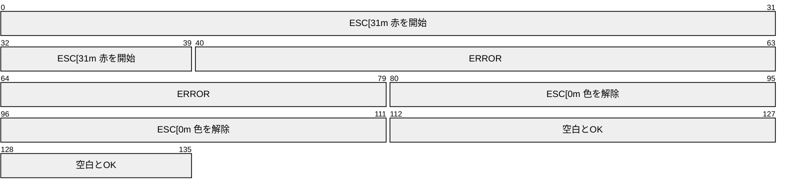

# 端末の色付きログの仕組みを確かめる｜xterm.js

端末の色付きログには、画面に出ない命令が含まれます。赤を開始する命令と、色を元に戻す命令を分けて観察します。

## 最初に知っておく用語

- **制御シーケンス**は、端末の表示を操作する文字の並びです。
- **リセット**は、色などを初期状態へ戻す命令です。

## パケット図で考える

一続きのバイト列を区間で見ます。図の範囲はビット番号です。色の解除を外すと、次の文字まで赤になります。

## ライブデモ

[公開用ライブデモ](https://papanda925.github.io/Daily-Code-Samples/demos/xterm-color-log/#live) ／ [実装HTML](../../docs/demos/xterm-color-log/index.html) ／ [共通JavaScript](../../docs/demos/browser-library-labs/daily.js)

1. 現行のブラウザーでデモを開く。Mermaidの描画や一部のライブラリーに外部通信を使用する。
2. 「実行」を押す。下記の値や画面内の操作欄を試す。

on と off で実行する。OK の色を見る。

### 結果の見方

解除を送らなければ OK にも赤が残る。

端末に渡される ESC は目に見えない文字だ。結果欄にはエスケープ表記が出る。赤色の指示と解除の間にどの文字があるかを見る。

## コードの要点

Terminal.write の結果と、制御文字を見える形にした文字列を並べる。

実装はデモ画面の「実装コード」で確認できます。

## 仕事で使うとき

ログ保存時は画面用の色と記録内容を分ける。

## 参考資料

- [xterm.jsの参照資料](https://github.com/xtermjs/xterm.js)
- [Mermaidの図の書き方](https://mermaid.js.org/intro/syntax-reference.html)

本文はAIを利用して作成しました。

## 実行環境と検証

JavaScriptの構文とファイル間の対応を確認した。 Pagesでの各機能の実行とMermaidの描画は検証範囲に含まれていない。

図が表示されない場合は、本文の読み方とMermaidソースを参照する。デモ欄に取得エラーが出る場合は通信条件を確認する。検証用の架空データを使う。
