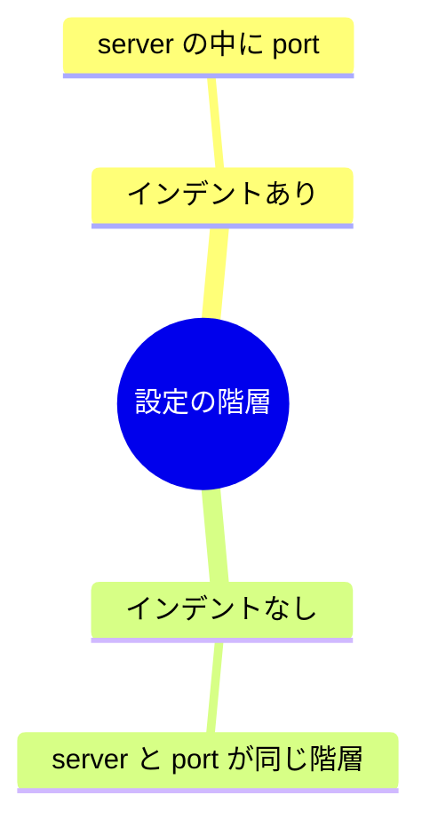

# 設定ファイルのインデントで構造が変わる理由｜yaml

YAMLでは、キーの手前の空白が親子関係を決めます。一行の空白を消し、同じ名前がどこへ移るかを見ます。

## 最初に知っておく用語

- **YAML**は、設定を階層で書けるテキスト形式です。
- **インデント**は、行頭の空白で示す階層です。

## マインドマップで考える

中央から左右のケースを読みます。port の先頭に空白を付けると所属先が変わります。

## ライブデモ

[公開用ライブデモ](https://papanda925.github.io/Daily-Code-Samples/demos/yaml-indentation/#live) ／ [実装HTML](../../docs/demos/yaml-indentation/index.html) ／ [共通JavaScript](../../docs/demos/browser-library-labs/daily.js)

1. 現行のブラウザーでデモを開く。Mermaidの描画や一部のライブラリーに外部通信を使用する。
2. 「実行」を押す。下記の値や画面内の操作欄を試す。

port の先頭を2空白にする。次に空白を消す。

### 結果の見方

同じキーが別の階層に移る。

空白を消すと server の値が空になり、port が同じ階層に移る。エラーがない場合でも設定の意味が変わる点が重要だ。

## コードの要点

parseDocument の結果をJSON表示し、errors があれば位置を確認する。

実装はデモ画面の「実装コード」で確認できます。

## 仕事で使うとき

設定変更は整形後だけでなく、変換した構造でもレビューする。

## 参考資料

- [yamlの参照資料](https://github.com/eemeli/yaml)
- [Mermaidの図の書き方](https://mermaid.js.org/intro/syntax-reference.html)

本文はAIを利用して作成しました。

## 実行環境と検証

JavaScriptの構文とファイル間の対応を確認した。 Pagesでの各機能の実行とMermaidの描画は検証範囲に含まれていない。

図が表示されない場合は、本文の読み方とMermaidソースを参照する。デモ欄に取得エラーが出る場合は通信条件を確認する。検証用の架空データを使う。
