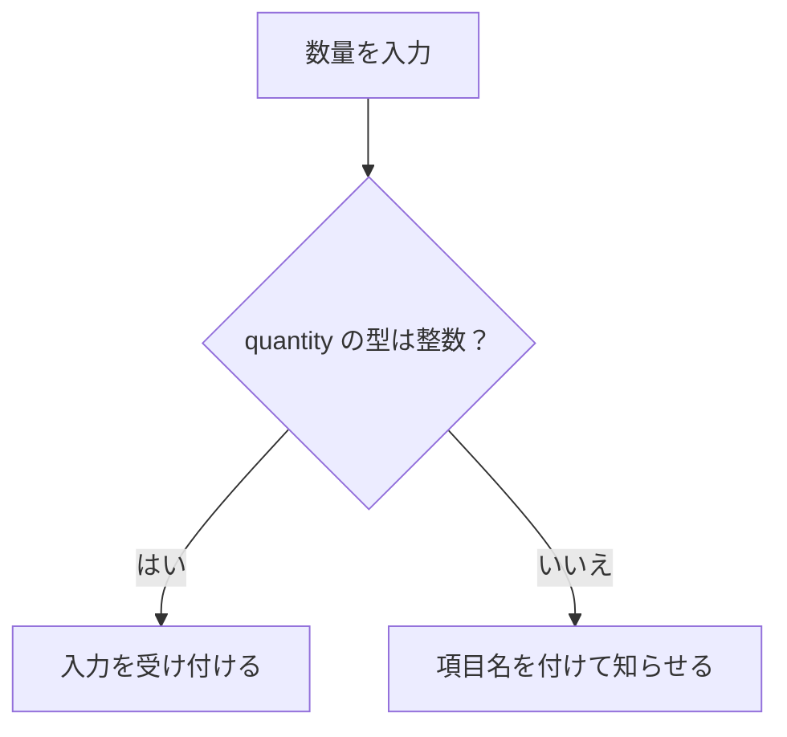

# 申請JSONのどの項目が不正か表示する｜Zod

入力欄に同じ2が見えても、文字列と数値では型が違います。Zodで数量を検査し、利用者に示すエラーの位置を取り出します。

## 最初に知っておく用語

- **スキーマ**は、入力の形と制約を定めたルールです。
- **パス**は、誤りが起きた項目の位置です。

## 分岐のフローチャートで考える

ひし形で「quantity の型は整数」を確認します。結果によって次に進む先が変わります。

## ライブデモ

[公開用ライブデモ](https://papanda925.github.io/Daily-Code-Samples/demos/zod-quantity-validation/#live) ／ [実装HTML](../../docs/demos/zod-quantity-validation/index.html) ／ [共通JavaScript](../../docs/demos/browser-library-labs/daily.js)

1. 現行のブラウザーでデモを開く。Mermaidの描画や一部のライブラリーに外部通信を使用する。
2. 「実行」を押す。下記の値や画面内の操作欄を試す。

数量を文字列のまま実行する。引用符を外して実行する。

### 結果の見方

文字列では quantity がエラーになる。数値の 2 は通る。

引用符を外すと値の見た目は同じでも型が変わる。入力画面で数量を数値として送る設計なら、負数と小数も別のテストにする。

## コードの要点

z.number().int() を含むオブジェクトを safeParse し、失敗時に issue の path を表示する。

実装はデモ画面の「実装コード」で確認できます。

## 仕事で使うとき

APIが受け取る型を操作画面の担当者と共有する。型変換を行うならその前後を別にテストする。

## 参考資料

- [Zodの参照資料](https://github.com/colinhacks/zod)
- [Mermaidの図の書き方](https://mermaid.js.org/intro/syntax-reference.html)

本文はAIを利用して作成しました。

## 実行環境と検証

JavaScriptの構文とファイル間の対応を確認した。 Pagesでの各機能の実行とMermaidの描画は検証範囲に含まれていない。

図が表示されない場合は、本文の読み方とMermaidソースを参照する。デモ欄に取得エラーが出る場合は通信条件を確認する。検証用の架空データを使う。
